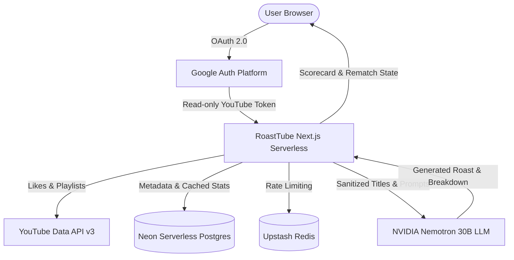

# 📺 RoastTube — How Cooked is Your YouTube?

[](https://nextjs.org/)
[](https://react.dev/)
[](https://www.typescriptlang.org/)
[](https://neon.tech/)
[](https://tailwindcss.com/)
[](https://roasttube.vercel.app)
[](https://opensource.org/licenses/MIT)

> **Live Production App:** [https://roasttube.vercel.app](https://roasttube.vercel.app)

RoastTube connects to your YouTube account via Google OAuth (read-only), scans your viewing habits, liked videos, and playlists, and unleashes an AI language model to ruthlessly critique your media taste. It awards you an algorithmic **Brainrot Score (0–100)**, dynamic archetype badges, a downloadable scorecard, and allows you to battle friends in 1v1 roast-offs.

---

## ✨ Key Features

* **🔥 AI Roast Engine:** Select from 5 distinct personas (*Disappointed Indian Auntie, Gym Bro, Angry Gordon Ramsay Chef, Gen Alpha Brainrot King, Exhausted News Anchor*) across 3 languages (*English, Tanglish, Hinglish*) and 3 heat settings (*Mild, Medium, Maximum*).
* **🧠 Brainrot Scorecard & Archetypes:** Calculates statistical distributions over YouTube categories, watch velocity, and brainrot quotients. Unlocks custom archetype badges (*e.g., Skibidi Scholar, Alpha Sigmoid, Doomscroll Virtuoso, Cozylord, Academic Overthinker*).
* **⚔️ 1v1 Friend Battle Mode:** Generate custom invitation challenge links (`/battle/[code]`) to pit your algorithm against friends and see who has the more cooked feed with algorithmic compatibility metrics.
* **📸 Client-Side Card Export:** Export high-resolution, pixel-perfect PNG scorecards using `html-to-image` for sharing on Instagram Stories, WhatsApp, and X/Twitter.
* **🔒 100% Read-Only & Privacy Compliant:** Strictly requests `youtube.readonly`. Adheres to Google API Services User Data Policy, Limited Use requirements, and YouTube Terms of Service. One-click data deletion supported.

---

## 🛠️ Technology Stack

| Layer | Technologies |
|---|---|
| **Framework** | [Next.js 15 (App Router)](https://nextjs.org), React 19, TypeScript |
| **Styling** | Vanilla TailwindCSS, Neobrutalist / Comic aesthetic |
| **Authentication** | [NextAuth v5 (Auth.js)](https://authjs.dev) with Google OAuth 2.0 |
| **Database** | [Neon](https://neon.tech) Serverless PostgreSQL + Drizzle ORM |
| **Cache & Rate Limits** | Upstash Redis REST + in-memory encryption cache fallback |
| **AI Inference** | NVIDIA NIM API (`nemotron-3.5-lightning-30b-a3b`) |
| **Hosting** | Vercel Edge & Serverless Functions |
| **Testing** | Vitest with 138 unit tests covering API, ingestion, LLM, and prompt schemes |

---

## 📐 Architecture



---

## 🚀 Getting Started (Local Development)

### Prerequisites

* Node.js 18+ or 20+
* A Google Cloud Console project with YouTube Data API v3 enabled
* A Neon PostgreSQL database instance

### 1. Clone the repository

```bash
git clone https://github.com/Vishallakshmikanthan/roast-tube.git
cd roast-tube
npm install
```

### 2. Configure Environment Variables

Copy `.env.example` to `.env.local` and populate the values:

```bash
cp .env.example .env.local
```

Required variables:
* `AUTH_SECRET`: Random 32-byte secret (e.g., `openssl rand -base64 32`)
* `AUTH_GOOGLE_ID`: Google OAuth Client ID
* `AUTH_GOOGLE_SECRET`: Google OAuth Client Secret
* `AUTH_URL`: `http://localhost:3000` (or your live domain)
* `DATABASE_URL`: Neon PostgreSQL connection string
* `NIM_API_KEY`: NVIDIA NIM API Key

### 3. Run Database Migrations

```bash
npm run drizzle-kit push
```

### 4. Start Development Server

```bash
npm run dev
```

Open [http://localhost:3000](http://localhost:3000) to view the app locally.

### 5. Running Tests

```bash
npm run test
```

---

## 📜 Privacy & Compliance

RoastTube complies strictly with the [Google API Services User Data Policy](https://developers.google.com/terms/api-services-user-data-policy), including the Limited Use requirements.
* We do **not** store raw viewing history permanently.
* We do **not** sell or transfer user data to third parties.
* We do **not** use user data to train general AI or machine learning models.
* Users can erase their account records at any time directly on the [Privacy Policy](/privacy) page.

---

## 📄 License

This project is open-source and licensed under the [MIT License](LICENSE).

Developed with ❤️ by **[Vishallakshmikanthan](https://github.com/Vishallakshmikanthan)**.
